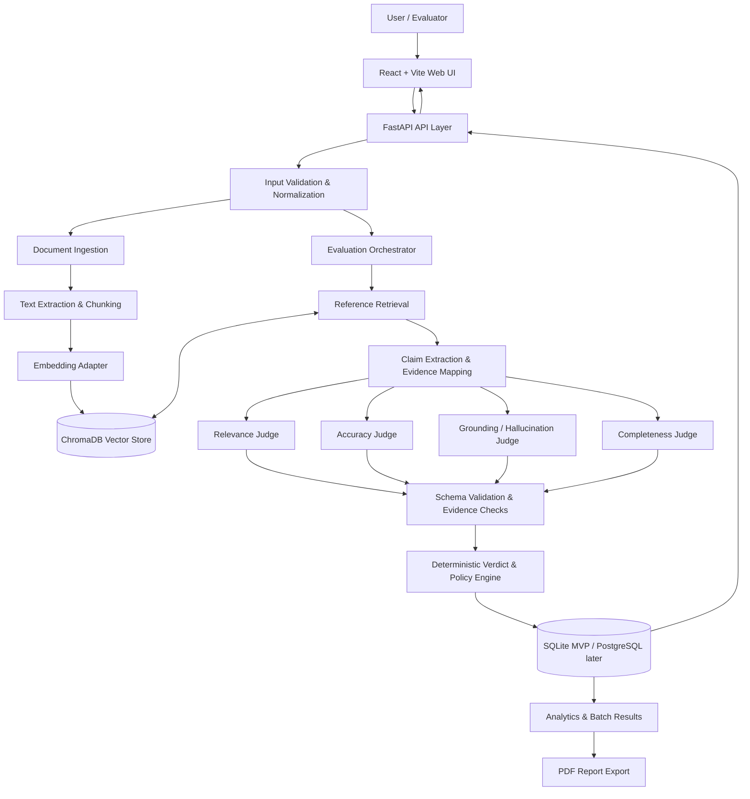

# System Architecture: AI Response Quality Evaluator Agent

**Document status:** Proposed architecture for MVP  
**Date:** 19 October 2026  
**Architecture style:** Modular monolith with asynchronous/batch-ready evaluation pipeline.

## 1. Design goals

- Keep each evaluation dimension independent and auditable.
- Make source evidence and uncertainty first-class outputs.
- Support a single evaluation and CSV batch evaluations through the same core service.
- Make LLM provider, embedding model, vector store, and score policy replaceable.
- Persist enough metadata to reproduce and compare evaluation runs.
- Avoid claiming that an LLM-generated score is objective ground truth.
- Start simple; introduce distributed services only when scale requires them.

## 2. High-level component diagram



The diagram shows logical components, not necessarily separate deployable services. For the MVP, they should live in one backend codebase. Document ingestion may run as a separate job for large files later.

## 3. Main modules and responsibilities

### 3.1 Frontend

- Single evaluation form: question, response, optional reference answer, optional source files.
- Batch upload: CSV upload, column mapping, validation preview, run status, row-level results.
- Evaluation detail: dimension scores, explanations, claim findings, evidence excerpts, source metadata, verdict.
- Dashboard: score distributions, pass/fail rates, common failure types, model/run comparisons, trend charts.
- Reports: export individual or batch evaluation summary to PDF/CSV.

### 3.2 API layer

FastAPI routes validate requests, enforce upload limits, invoke services, and return stable response schemas. The API layer should not contain judge prompts or score aggregation logic directly.

### 3.3 Input validation and normalization

- Validate required fields and text lengths.
- Normalize blank reference fields to an explicit evaluation mode.
- Validate file extension, MIME type, size, and row limits.
- Reject malformed CSVs and ambiguous column mappings with actionable messages.
- Assign an evaluation ID and preserve an input hash for deduplication/caching where appropriate.

### 3.4 Reference ingestion and retrieval

- Extract text from supported file formats.
- Chunk by paragraphs/sections where possible; retain page/section offsets and source identifiers.
- Embed chunks through a configurable embedding adapter.
- Store vectors and metadata in ChromaDB.
- Retrieve top-k chunks using the question and optionally individual response claims.
- Return retrieval metadata, scores, and chunk IDs to downstream judges.
- Keep retrieval-quality findings distinct from answer-quality findings.

### 3.5 Claim extraction and evidence mapping

Break the candidate response into atomic, independently verifiable factual claims. Preserve the original text span for each claim. The claim extractor must not silently discard qualifications, negation, dates, quantities, or attributions.

For each claim, retrieve or select relevant evidence and assign one of these labels:

- `SUPPORTED`: evidence entails or clearly supports the claim.
- `CONTRADICTED`: evidence directly conflicts with the claim.
- `UNSUPPORTED`: the provided evidence does not support the claim, but does not establish that it is false.
- `INSUFFICIENT_EVIDENCE`: evidence coverage or quality is too weak to make a sound judgment.
- `CONFLICTING_SOURCES`: supplied sources materially disagree.

Every evidence-backed label should include source IDs and short excerpts. If evidence is not available, return an explicit status rather than fabricated citations.

### 3.6 Judge agents

Each judge is a typed service/function with a separate rubric, prompt version, and output schema. Agents may execute in parallel after common inputs and retrieved evidence are ready.

#### Relevance Judge

**Inputs:** question, response  
**Outputs:** score 0–100, rationale, off-topic spans, optional ambiguity note  
**Does not:** judge factual truth as its primary task.

#### Accuracy Judge

**Inputs:** question, response, optional reference answer, retrieved evidence  
**Outputs:** score 0–100, factual findings, evidence references, uncertainty status  
**Rule:** if no reference or source exists, explicitly mark reference-based accuracy as not assessable; an optional general-knowledge mode must be labelled separately.

#### Grounding / Hallucination Judge

**Inputs:** response claims, retrieved passages, source metadata  
**Outputs:** per-claim support label, evidence excerpt, source/chunk IDs, confidence/uncertainty, aggregate grounding-safety score  
**Rule:** do not label a claim false solely because it is absent from the retrieved context.

#### Completeness Judge

**Inputs:** question, response, reference answer or expected answer elements where available  
**Outputs:** score 0–100, required elements covered, missing elements, rationale  
**Rule:** distinguish true omissions from information that is not required by the question.

### 3.7 Verdict and policy engine

The Verdict Agent is implemented as an LLM-assisted summarizer plus a deterministic policy engine. Numeric aggregation and critical-failure rules must be code, not left solely to free-form model judgment.

Initial weights:

| Dimension | Weight |
|---|---:|
| Relevance | 0.20 |
| Accuracy | 0.30 |
| Grounding safety | 0.30 |
| Completeness | 0.20 |

`overall_score = 0.20R + 0.30A + 0.30H + 0.20C`

Initial verdict bands: `PASS >= 80`, `NEEDS_IMPROVEMENT >= 60 and < 80`, `FAIL < 60`.

A configurable critical-failure policy may cap or fail an evaluation when a central claim is contradicted. The final response should include the weighted score, each component score, any applied cap/failure rule, and a concise consolidated rationale. If a dimension is not assessable, the aggregation policy must explicitly decide whether to renormalize weights, mark the overall verdict provisional, or require a reference; do not silently substitute zero.

### 3.8 Batch processing

- Parse and validate CSV rows.
- Require or map columns for `question` and `response`; optionally accept `reference_answer`, `source_text`, `model_name`, `sample_id`.
- Create a batch record and one evaluation record per valid row.
- Track row statuses: `QUEUED`, `RUNNING`, `SUCCEEDED`, `FAILED`, `SKIPPED`.
- Support per-row retries for transient provider errors, with bounded retries.
- Persist failures and error categories; do not discard partial batch results.
- Provide progress, aggregated metrics, downloadable row-level results, and report generation.

For the MVP, synchronous or lightweight background tasks may be sufficient. Move to a durable queue (for example, Redis-backed workers) only when expected batch size or timeouts justify it.

## 4. Suggested repository structure

```text
ai-response-quality-evaluator/
├── README.md
├── docs/
│   ├── RESEARCH_ANALYSIS.md
│   └── ARCHITECTURE.md
├── backend/
│   ├── pyproject.toml
│   ├── app/
│   │   ├── main.py
│   │   ├── api/routes/
│   │   ├── core/config.py
│   │   ├── schemas/
│   │   ├── services/
│   │   │   ├── evaluation_orchestrator.py
│   │   │   ├── verdict_service.py
│   │   │   ├── batch_service.py
│   │   │   └── report_service.py
│   │   ├── agents/
│   │   │   ├── base.py
│   │   │   ├── relevance.py
│   │   │   ├── accuracy.py
│   │   │   ├── grounding.py
│   │   │   └── completeness.py
│   │   ├── retrieval/
│   │   │   ├── ingestion.py
│   │   │   ├── chunking.py
│   │   │   ├── embeddings.py
│   │   │   └── vector_store.py
│   │   ├── db/
│   │   └── prompts/
│   └── tests/
├── frontend/
│   ├── package.json
│   └── src/
├── datasets/
│   ├── README.md
│   └── samples/             # small synthetic examples only
├── scripts/
├── .env.example
├── .gitignore
└── LICENSE
```

This is a proposed future structure; folders should be added when their code is implemented. Do not commit API keys, uploaded private documents, vector database contents, or benchmark datasets unless redistribution is permitted.

## 5. API design (initial contract)

### `POST /api/v1/evaluations`

Create a single evaluation.

Example request:

```json
{
  "question": "What does the reference say about the event?",
  "response": "The event occurred in 2020.",
  "reference_answer": "The event occurred in 2021.",
  "source_ids": [],
  "mode": "reference_grounded",
  "model_label": "candidate-model-a"
}
```

Response should return an `evaluation_id`, status, dimension results, claim findings, weighted score, verdict, and timestamps. Use asynchronous status polling if evaluation latency warrants it.

### `POST /api/v1/batches`

Upload a CSV, validate headers, create a batch, and return `batch_id` plus accepted/rejected row counts.

### `GET /api/v1/batches/{batch_id}`

Return batch status, progress, aggregate metrics, and error summary.

### `GET /api/v1/batches/{batch_id}/results`

Return paginated row-level evaluation results.

### `GET /api/v1/evaluations/{evaluation_id}`

Return a full evaluation, including score explanations, source evidence, rubric version, and any limitations.

### `GET /api/v1/health`

Return service health without exposing secrets or internal infrastructure details.

## 6. Data model proposal

### `Evaluation`

- `id` (UUID)
- `created_at`, `completed_at`
- `question`, `response`
- `reference_answer` (nullable)
- `evaluation_mode` (`reference_grounded`, `source_grounded`, `general_knowledge`, `not_assessable`)
- `model_label` (nullable user-supplied label)
- `status`, `error_code` (nullable)
- `rubric_version`, `prompt_version`, `judge_model_id`
- `overall_score` (nullable), `verdict` (nullable)
- `input_hash` (optional)

### `DimensionResult`

- `id`, `evaluation_id`
- `dimension` (`relevance`, `accuracy`, `grounding`, `completeness`)
- `score` (nullable if not assessable)
- `status` (`ASSESSED`, `NOT_ASSESSABLE`, `FAILED`)
- `rationale`
- `raw_structured_output` (optional, with sensitive data controls)

### `ClaimFinding`

- `id`, `evaluation_id`, `claim_text`, `claim_start`, `claim_end`
- `label` (`SUPPORTED`, `CONTRADICTED`, `UNSUPPORTED`, `INSUFFICIENT_EVIDENCE`, `CONFLICTING_SOURCES`)
- `evidence_excerpt`, `source_id`, `chunk_id`
- `judge_confidence` (optional; not a calibrated probability unless validated)
- `rationale`

### `SourceDocument` and `SourceChunk`

Store source metadata and stable chunk IDs. Keep raw documents out of public logs and make retention policy explicit.

### `Batch`

- `id`, `created_at`, `status`
- `input_filename`, `total_rows`, `completed_rows`, `failed_rows`
- `configuration_snapshot`, `aggregate_metrics`

## 7. Structured output contract

All judges should return JSON conforming to versioned Pydantic schemas. Example grounding finding:

```json
{
  "dimension": "grounding",
  "score": 35,
  "status": "ASSESSED",
  "summary": "The response contains a claim that conflicts with the supplied source.",
  "findings": [
    {
      "claim": "The event occurred in 2020.",
      "label": "CONTRADICTED",
      "evidence": "The supplied reference states that the event occurred in 2021.",
      "source_id": "reference-1",
      "chunk_id": "reference-1-chunk-0"
    }
  ]
}
```

The backend must verify that each returned source/chunk ID exists in the retrieval result and that cited evidence is present in the source text. If validation fails, mark the finding invalid or retry once with a constrained prompt; never display fabricated citations as verified evidence.

## 8. Security, privacy, and abuse considerations

- Store provider API keys in environment variables or a secret manager; never in source control or browser code.
- Add `.env` and local database/vector-store paths to `.gitignore`.
- Treat uploaded documents and retrieved passages as untrusted data, not instructions.
- Apply upload type/size limits, CSV row limits, rate limits, and bounded retries.
- Avoid logging full private inputs by default; define retention and deletion behavior.
- Sanitize filenames and generated report names.
- Use access control before exposing evaluations to multiple users.
- Explain which external LLM provider receives the user's data.
- Review dataset licences before including benchmark samples or redistribution.

## 9. Observability and reproducibility

Record at least:

- Evaluation and batch IDs.
- Timestamps and execution status.
- Model/provider identifier and version when available.
- Prompt/rubric version.
- Retrieval parameters and retrieved chunk IDs.
- Scores, labels, explanations, and schema validation errors.
- Latency and estimated token/cost metrics when available.
- Critical-failure rules and weights applied.

Avoid logging secrets or sensitive source text unnecessarily. Make it possible to compare two runs using the same inputs and rubric.

## 10. Testing strategy

1. **Unit tests:** schema validation, score normalization, weighted aggregation, verdict bands, critical-failure caps, missing-reference behavior.
2. **Agent contract tests:** valid JSON, allowed labels, score range, evidence references are traceable.
3. **Retrieval tests:** known queries retrieve expected source chunks; measure recall@k on a small labelled set.
4. **Integration tests:** single evaluation from input through persistence; source upload and retrieval; batch CSV with valid and invalid rows.
5. **Regression tests:** fixed test set for prompts/models; review score changes when prompt/model versions change.
6. **Human agreement tests:** compare dimension scores and claim labels to reviewer annotations.
7. **Adversarial tests:** prompt injection in source text, contradictory sources, irrelevant retrieval, missing references, very long answers, malformed CSV, and provider timeouts.
8. **Load/cost tests:** representative batch sizes and rate-limit behavior.

## 11. Deployment approach

### MVP / local development

- React frontend and FastAPI backend.
- SQLite database.
- ChromaDB local persistence.
- One configured LLM provider and one embedding option.
- Local `.env` file excluded from Git.

### Later production-oriented evolution

- PostgreSQL for durable multi-user persistence.
- Durable background queue for large batches.
- Object storage for permitted uploaded documents and reports.
- Authentication, tenant isolation, audit logs, and retention controls.
- Centralized metrics and error monitoring.
- Model-provider fallback only with explicit cost, privacy, and consistency policy.

## 12. Key architecture decisions

| Decision | Initial choice | Reason | Revisit when |
|---|---|---|---|
| Deployment shape | Modular monolith | Lowest complexity for an academic MVP | Independent scaling or ownership becomes necessary |
| Orchestration | Deterministic Python service; optional LangGraph later | Pipeline is mostly fixed and easy to audit | Complex state, retries, branching, or human review emerge |
| Vector store | ChromaDB | Simple local retrieval and metadata storage | Scale or operational requirements demand another store |
| Database | SQLite initially | Fast setup and local demo | Multi-user concurrency or hosted deployment is needed |
| Score aggregation | Deterministic service | Reproducible thresholds and weighted score | Policy requirements change; keep changes versioned |
| LLM judge output | Schema-constrained JSON | Reliable downstream processing | Provider limitations require alternate constrained decoding |
| Evidence labels | Supported / contradicted / unsupported / insufficient / conflicting | Avoid conflating missing evidence with falsity | Domain-specific taxonomies are validated |

## 13. Open questions before implementation

- Which LLM provider/model will be used for the first demo, and what is the API budget?
- Which document formats are required in the MVP (PDF, TXT, DOCX, HTML)?
- What is the expected maximum CSV size and concurrent batch count?
- Will the first release support user accounts or remain a single-user local app?
- Which benchmark data can be legally redistributed, and which should only be downloaded by the user?
- Which human-annotation rubric and minimum agreement targets will be used?
